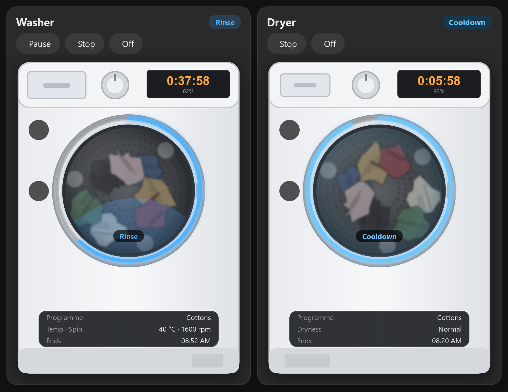
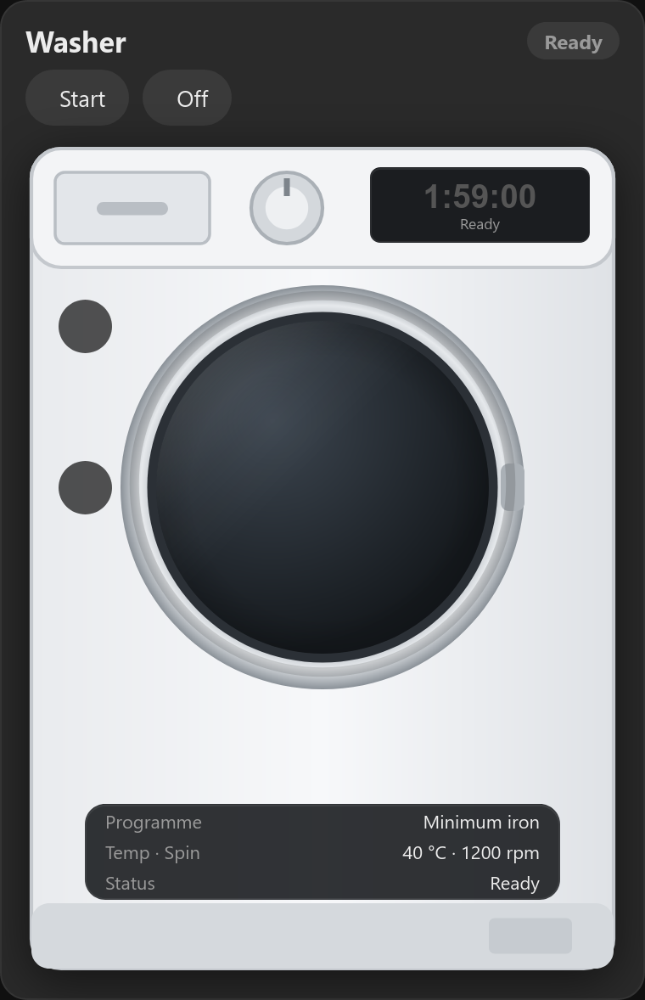
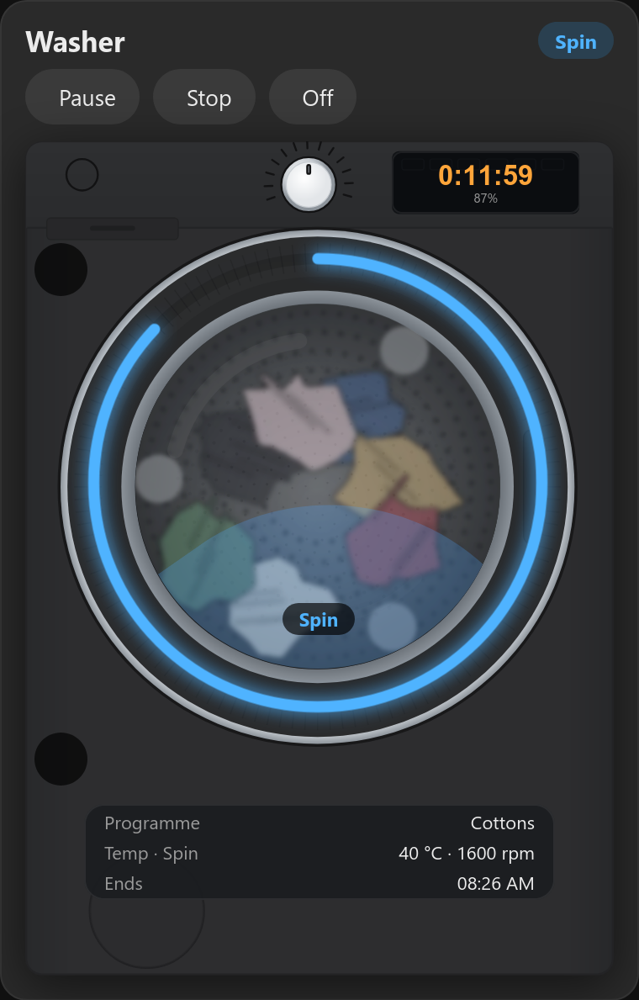

# Miele Appliance Card for Home Assistant

A washer and tumble dryer card for **Miele** machines that use Home Assistant's built-in
[Miele integration](https://www.home-assistant.io/integrations/miele/).

The machine is drawn on the card with a progress ring round the door, the time left on its display, and the
laundry turning while it runs. You can start, pause, resume and stop a cycle from the card, and switch the machine off.

> **Beta.** I don't own a Miele. The card is built from the integration's source code and tested against
> simulated states. If you try it, please [open an issue](../../issues) with your model and what you see.
> That's how it gets out of beta.

Sister card of the [hOn washer & dryer card](https://github.com/spikey1965/ha-hon-appliance-card) (Haier, Candy, Hoover)
and the [Candy card](https://github.com/spikey1965/ha-candy-appliance-card) (Candy Simply-Fi).



## What it shows

- Status: Off, On, Ready, Delayed start, Running (with the phase: Washing, Rinse, Spin, Drying, Cooldown ...), Paused, Finished, Error
- Time left on the machine's display, the end time, and a progress ring round the door
- Programme, temperature and spin speed (washer) or dryness (dryer)
- The door (open, closed, locked while it runs) and Remote Control
- **Start**, **Pause**, **Resume** and **Stop** (Stop asks first), and **Off** using the machine's power switch

The buttons only show when the machine will take them at that moment. For example, there's no Pause during a delayed start.



**Limits that come from the integration and the machine:**
- The buttons only work with **Remote Control** switched on at the machine.
- You can't pick a programme from the card. Miele's integration needs a programme number to start one, and it doesn't
  tell Home Assistant which numbers your machine has. So choose the programme on the machine, then press **Start** on the card.
- No cycle count, because the integration doesn't have one.

## Install

**HACS:** HACS → ⋮ → Custom repositories → add `https://github.com/spikey1965/ha-miele-appliance-card`, type **Dashboard**.
Then find "Miele Appliance Card", download it, and reload the browser. While it's a pre-release, open it in HACS
and switch on "Show beta versions" if it isn't offered.

**Manual:** copy `miele-appliance-card.js` to `/config/www/`, then add a dashboard resource
(Settings → Dashboards → ⋮ → Resources): `/local/miele-appliance-card.js?v=0.1.0`, type **JavaScript module**.

It can sit alongside the hOn card. They use different card names.

## Use

```yaml
type: custom:miele-appliance-card
appliance: washer
```

```yaml
type: custom:miele-appliance-card
appliance: dryer
```

The card finds your machine by itself: the first Miele washer (or dryer, with `appliance: dryer`). The Miele
integration names its entities in Home Assistant's language (`sensor.waschmaschine_programmphase` in German), so the
card finds them through the integration instead of by name, and it works in any language.

If you have more than one Miele washer or dryer, set `entity` to the machine's status sensor, the one with no ending,
such as `sensor.washing_machine` or `sensor.waschmaschine`.

| Option | Default | What it does |
|---|---|---|
| `appliance` | `washer` | `washer` or `dryer` |
| `entity` | first Miele machine | the machine's status sensor, e.g. `sensor.waschmaschine` |
| `name` | Washer / Dryer | card title |
| `colour` | blue / orange | accent colour, e.g. `"#4fb3ff"` |
| `style` | `drawn` | `photo` = a more detailed illustration |
| `finish` | `white` | machine colour: `white`, `graphite` or `black` |
| `max_width` | `440px` | |
| `images` | built in | a folder with your own `washer.svg`, `dryer.svg` and `laundry-drum.webp` |



## Troubleshooting

- **No buttons:** switch Remote Control on at the machine. Pause, Resume and Stop also hide when the machine says it
  won't take them right now.
- **Card shows Off and "—" everywhere:** the card didn't find a Miele washer (or dryer). Set `entity` to the machine's
  status sensor (Developer Tools → States, search for your machine's name).
- **Something else looks wrong:** please open an issue with your model and a screenshot of Developer Tools → States
  filtered for your machine.

## Thanks

Built from **MrMoep**'s detailed write-up of the Miele entities on the hOn card's issue tracker.
Card by [My Media Build](https://mymediabuild.uk), with a [step-by-step guide](https://mymediabuild.uk/home-assistant-miele-washer-dryer-card/).
If you find it useful, you can [buy me a coffee](https://buymeacoffee.com/bobgreggr) ☕ (no pressure).

## Licence

MIT. Not affiliated with or endorsed by Miele.
